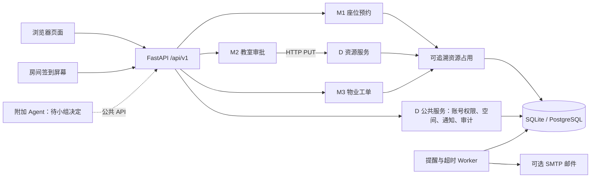

# 系统结构与主要流程

## PR #1 中的架构提案

PR #1 提议由浏览器访问 FastAPI 主服务。M1/M2/M3 的业务规则仍在同一套代码中；M2 终审额外通过 HTTP 调用独立的 D 资源进程。资源进程与主 API 共用数据库，负责在一个事务里重新鉴权、锁定申请和空间、检查冲突并写入审批记录和整室占用。SQLite 用于本机开发，Compose 使用 PostgreSQL；Alembic 维护表结构；定时 worker 独立运行，配置 SMTP 后投递邮件。

这是一项待组内确认的架构提案，不是已通过的长期决策。课程任务书要求期末展示一条模块 A 通过网络调用模块 B 并写回状态的跨模块链路；当前 M2 到 D 的 HTTP 请求可作为候选演示。D 的负责人、公共接口治理以及是否长期拆服务仍需按 [AD-001 决策记录](decision-record.md) 由组员讨论。

图中虚线的 Agent 目前不是已部署的组件。后端的预览/确认接口是留给未来适配器的业务入口，不代表 DSH 已接入。

### 部署与信任边界

- 浏览器只访问主 API 暴露的公开 `/api/v1` 接口。`/internal/v1/classroom-holds/{申请单号}` 是资源进程的内部接口，不应发布到公网。
- 主 API 在收到二级审批后释放本地事务，再向资源进程发 HTTP PUT；资源进程从转发的会话凭据重新认证用户，不能只相信主 API 传来的用户编号。
- Compose 中 API、资源进程和 worker 位于同一应用网络并连接同一 PostgreSQL。生产部署在不同主机时，应配置 HTTPS、私有网络和凭据保护。
- 资源进程不可用或响应丢失时，客户端应刷新申请状态；相同审批人和备注可以安全重试。终审与占用必须一起提交，不能只写其中一项。
- 本地开发需要 API、资源服务和 worker；Compose 同时启动数据库、API、资源服务和 worker。启动命令见 [部署说明](deployment.md)。

### 主要请求流

**M1 个人预约**：Web 搜索 → 主 API 检查账号、权限、空间范围、开放时间和占用 → 创建 `Reservation` → 写审计/通知 → 返回预约编号。查询结果不可代替最终写入时的冲突校验。

**M2 整室预约**：申请进入待审批但不占座 → 一级审批通过后进入下一阶段 → 终审 API 通过 HTTP 调用资源进程 → 资源进程再次检查权限、时限、房间状态和占用 → 同一事务写审批、`ResourceHold`、审计和通知 → M1 后续查询显示被整室占用。

**M3 报修**：上报 → 派单 → 维修开始时创建 M3 `ResourceHold` → 维修完成但尚未验收时继续占用 → 验收通过后按工单号释放该占用。

**后台任务**：worker 周期检查提醒、未签到释放、审批超时、SLA 升级和待发邮件。通知唯一键及业务状态用于避免任务重复执行造成重复记录。

## 模块边界

| 模块 | 负责什么 | 主要代码 |
| --- | --- | --- |
| M1 | 座位查询、预约、取消、历史复用、签到和未签到释放 | `backend/campus_app/routers/m1.py`、`domain.py` |
| M2 | 整教室申请、分级审批、拒绝、取消和超时 | `backend/campus_app/routers/m2.py`、`domain.py` |
| M3 | 报修、派单、维修、SLA 升级、验收与评价 | `backend/campus_app/routers/m3.py`、`domain.py` |
| D | 登录身份、角色权限、房间与座位、站内/邮件通知、操作审计 | `auth.py`、`shared.py`、`rbac.py`、`worker.py` |
| Web | 学生页面、审批/维修台、管理页和签到屏幕 | `demo/` |
| 数据迁移 | 从空库创建与演进表结构 | `backend/migrations/` |

M1 个人预约写入 `Reservation`，M2 和 M3 写入带模块和来源单号的 `ResourceHold`。M2 只有最终审批通过才创建整间教室的占用；M3 只有工单进入维修中才下架相关空间；M1 查询时汇总占用并返回原因。各业务处理释放时按原来源单号撤销记录。

### M2 终审网络契约

主服务收到二级通过请求后释放本地事务，再用经配置的内部地址调用 `PUT /internal/v1/classroom-holds/{申请单号}`。资源进程用当前用户的会话凭据重新鉴权，在一个事务内锁定申请和房间，复查开放时段、冲突和审批期限，写入终审记录、整室占用、通知及审计。两侧使用同一版代码和同一数据库。取消已批准的申请时，现有取消事务根据来源单号释放占用。部署在受信的组内网络，跨主机传递凭据时配置 HTTPS。

冲突返回 409，申请仍可处理。资源服务不可达或响应丢失返回 503，调用方先刷新状态，也可以用相同审批人和备注重试；已提交的终审只返回原结果。现场从 `docker compose logs -f resource` 观察 PUT 请求，用相同申请单号在座位查询中核对占用来源。

## 主要业务接口

接口版本前缀为 `/api/v1`；交互式 API 说明在开发模式 `/api/docs`。

| 方法/路径 | 模块 | 用途 |
| --- | --- | --- |
| `GET /api/v1/seats` | M1 | 按日期、时间、时长及设备筛选座位和占用来源 |
| `POST /api/v1/reservations` | M1 | 创建座位预约；支持幂等键 |
| `GET /api/v1/reservations` | M1 | 查看本人预约和历史 |
| `POST /api/v1/reservations/{id}/check-in` | M1 | 用房间当日码签到 |
| `POST /api/v1/classroom-applications` | M2 | 提交整室申请 |
| `POST /api/v1/classroom-applications/{id}/decision` | M2 | 有权限的审批人做当前级别决定 |
| `POST /api/v1/work-orders` | M3 | 提交故障 |
| `POST /api/v1/work-orders/{id}/start` | M3 | 开始维修并下架资源 |
| `POST /api/v1/work-orders/{id}/accept` | M3 | 验收并释放维修占用 |
| `POST /api/v1/agent/actions/preview` 与 `/confirm` | 可选适配接口 | 生成待确认摘要，并在确认后重新校验执行 |

## 数据与安全

- 账号密码只保存哈希；会话、API 凭据和房间屏幕令牌分别校验用途。屏幕令牌被限制在单一房间，不能用于用户登录。
- 每个管理接口在服务端检查权限；前端隐藏按钮只是体验处理，不是安全边界。
- 屏幕每日签到码由服务端按房间和日期生成，响应禁止缓存；预约记录不会返回签到码。
- 预约写操作检查房间开放时间、部门可见范围、系统上限、冲突及幂等键。
- 站内通知始终可用；邮件仅在用户填写邮箱且 SMTP 已启用时排队发送。邮件发送最多重试配置次数，错误日志不写 SMTP 密码。
- 演示种子账号、房间和预约都是虚构数据；生产环境必须关闭种子数据，并设置至少 32 字符随机 `APP_SECRET`。

M1、M2、M3 和 D 共用实体的写入责任、字段约束、状态来源、事务及变更评审规则见 [共享信息约束与管理](shared-data-governance.md)。模块不能因为能连接同一数据库，就绕过其他模块的业务接口直接改其业务记录。

## 异步处理和已知限制

单独 worker 每 30 秒处理预约提醒、未签到、审批超时和工单 SLA。数据库唯一通知键避免重复生成；邮件采用有限重试。课程规模目前使用数据库轮询，不依赖 Redis；部署时只运行一个 worker 实例，避免多个 worker 同时投递同一封邮件。

旧版本的 GitHub Actions CI 和临时 Compose 测试环境曾通过；PR #1 当前 head 尚未显示检查结果或人工 review，因此不能把旧运行记录当作这次变更已通过。当前没有实际 SMTP 账号、微信通知通道、正式学校身份认证或生产服务器。跨日预约不支持。正式审批/违约/报修政策需由小组向老师或场地管理员确认。
