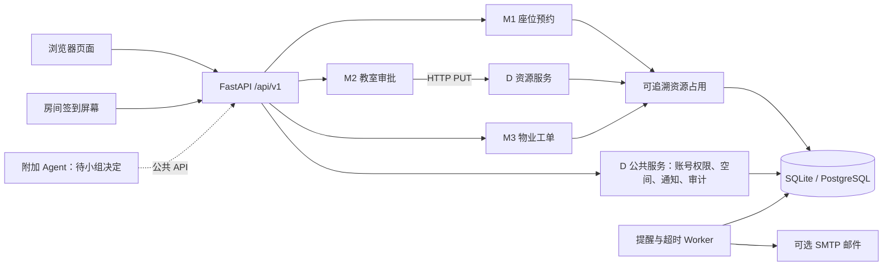

# 系统结构与主要流程

## 当前实现

浏览器访问 FastAPI 主服务。M2 终审通过 HTTP 调用独立的 D 资源进程，其他业务复用同一应用的领域逻辑和数据库。SQLite 用于本机开发，Compose 使用 PostgreSQL；Alembic 维护表结构。定时 worker 独立运行，配置 SMTP 后投递邮件。

图中虚线的 Agent 目前不是已部署的组件。后端的预览/确认接口是留给未来适配器的业务入口，不代表 DSH 已接入。

## 模块边界

| 模块 | 负责什么 | 主要代码 |
| --- | --- | --- |
| M1 | 座位查询、预约、取消、历史复用、签到和未签到释放 | `backend/campus_app/routers/m1.py`、`domain.py` |
| M2 | 整教室申请、分级审批、拒绝、取消和超时 | `backend/campus_app/routers/m2.py`、`domain.py` |
| M3 | 报修、派单、维修、SLA 升级、验收与评价 | `backend/campus_app/routers/m3.py`、`domain.py` |
| D | 登录身份、角色权限、房间与座位、站内/邮件通知、操作审计 | `auth.py`、`shared.py`、`rbac.py`、`worker.py` |
| Web | 学生页面、审批/维修台、管理页和签到屏幕 | `demo/` |
| 数据迁移 | 从空库创建与演进表结构 | `backend/migrations/` |

M1 个人预约写入 `Reservation`，M2 和 M3 写入带模块和来源单号的 `ResourceHold`。M2 只有最终审批通过才创建整间教室的占用；M3 只有工单进入维修中才下架相关空间；M1 查询时汇总占用并返回原因。各业务处理释放时按原来源单号撤销记录。

### M2 终审网络契约

主服务收到二级通过请求后释放本地事务，再用经配置的内部地址调用 `PUT /internal/v1/classroom-holds/{申请单号}`。资源进程用当前用户的会话凭据重新鉴权，在一个事务内锁定申请和房间，复查开放时段、冲突和审批期限，写入终审记录、整室占用、通知及审计。两侧使用同一版代码和同一数据库。取消已批准的申请时，现有取消事务根据来源单号释放占用。部署在受信的组内网络，跨主机传递凭据时配置 HTTPS。

冲突返回 409，申请仍可处理。资源服务不可达或响应丢失返回 503，调用方先刷新状态，也可以用相同审批人和备注重试；已提交的终审只返回原结果。现场从 `docker compose logs -f resource` 观察 PUT 请求，用相同申请单号在座位查询中核对占用来源。

## 主要业务接口

接口版本前缀为 `/api/v1`；交互式 API 说明在开发模式 `/api/docs`。

| 方法/路径 | 模块 | 用途 |
| --- | --- | --- |
| `GET /api/v1/seats` | M1 | 按日期、时间、时长及设备筛选座位和占用来源 |
| `POST /api/v1/reservations` | M1 | 创建座位预约；支持幂等键 |
| `GET /api/v1/reservations` | M1 | 查看本人预约和历史 |
| `POST /api/v1/reservations/{id}/check-in` | M1 | 用房间当日码签到 |
| `POST /api/v1/classroom-applications` | M2 | 提交整室申请 |
| `POST /api/v1/classroom-applications/{id}/decision` | M2 | 有权限的审批人做当前级别决定 |
| `POST /api/v1/work-orders` | M3 | 提交故障 |
| `POST /api/v1/work-orders/{id}/start` | M3 | 开始维修并下架资源 |
| `POST /api/v1/work-orders/{id}/accept` | M3 | 验收并释放维修占用 |
| `POST /api/v1/agent/actions/preview` 与 `/confirm` | 可选适配接口 | 生成待确认摘要，并在确认后重新校验执行 |

## 数据与安全

- 账号密码只保存哈希；会话、API 凭据和房间屏幕令牌分别校验用途。屏幕令牌被限制在单一房间，不能用于用户登录。
- 每个管理接口在服务端检查权限；前端隐藏按钮只是体验处理，不是安全边界。
- 屏幕每日签到码由服务端按房间和日期生成，响应禁止缓存；预约记录不会返回签到码。
- 预约写操作检查房间开放时间、部门可见范围、系统上限、冲突及幂等键。
- 站内通知始终可用；邮件仅在用户填写邮箱且 SMTP 已启用时排队发送。邮件发送最多重试配置次数，错误日志不写 SMTP 密码。
- 演示种子账号、房间和预约都是虚构数据；生产环境必须关闭种子数据，并设置至少 32 字符随机 `APP_SECRET`。

## 异步处理和已知限制

单独 worker 每 30 秒处理预约提醒、未签到、审批超时和工单 SLA。数据库唯一通知键避免重复生成；邮件采用有限重试。课程规模目前使用数据库轮询，不依赖 Redis；部署时只运行一个 worker 实例，避免多个 worker 同时投递同一封邮件。

公开 GitHub 仓库已创建，GitHub Actions 的 CI 和临时 Compose 测试环境已通过；目前没有实际 SMTP 账号、微信通知通道、正式学校身份认证或生产服务器。跨日预约不支持。正式审批/违约/报修政策需由小组向老师或场地管理员确认。
