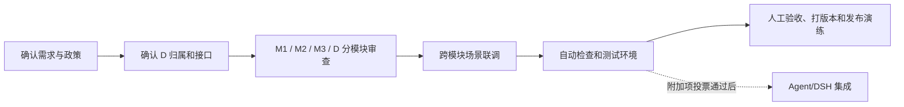

# 六人分工建议与启动评审

**状态：讨论建议，组员尚未确认。**以下 A–F 只是角色代号，不代表已认领或已完成工作。启动评审建议安排在 2026-11-05。代码目前主要由 coding agent 生成；六名组员接下来要做的是定需求、拆任务、审查、验证和交付，不能把建议表写成已经发生的贡献。

## 六人分工建议

| 成员 | 负责范围 | 会后交付 |
| --- | --- | --- |
| A | M1 自习座位预约 | M1 规则清单、代码审查记录和预约演示 |
| B | M2 整间教室审批 | M2 状态流程图、审查记录和审批测试证据 |
| C | M3 物业报修 | M3 状态流程图、审查记录和维修测试证据 |
| D | 公共服务 D 与模块接口 | 共用接口说明、跨模块评审记录和 D 决议 |
| E | 测试与交付 | 可复跑测试清单、验证记录和交付步骤 |
| F | Agent 附加项讨论；若不做则整理演示与 AI 记录 | Agent 决议及相应验证，或演示材料与 AI 使用记录 |

## 逐人职责与老师可能追问

### A｜M1 自习座位预约

负责确认座位查找、预约、取消、签到和未签到处理规则；对照任务书审查 M1 页面、接口和测试，并准备预约成功及冲突拒绝的演示。会上要确认预约最长时长、取消边界和未签到政策。

- **老师可能问：怎样避免同一个座位被重复预约？**答：预约前后都检查共享占用记录；相同请求有幂等处理，冲突请求会被拒绝。相关本地行为测试已通过。
- **老师可能问：没签到会怎么处理？**答：当前初稿能记录签到状态；未签到后的处罚和申诉规则还要由小组按任务书和老师意见确认，不先擅自设定惩罚。

### B｜M2 整间教室审批

负责确认申请字段、审批人和审批级数、时限、驳回及取消规则；审查教室何时锁定，以及审批取消后如何释放，并准备一条审批演示。会上要确认审批级数和逾期处理。

- **老师可能问：申请提交后会马上占用教室吗？**答：不会。初稿在最终审批通过后才建立占用，避免待审批申请长期挡住资源。
- **老师可能问：被驳回或取消后怎样释放？**答：对应申请状态会结束并释放占用；小组需要再确认课程要求的超时和取消细则。

### C｜M3 物业报修

负责确认报修内容、工单等级、服务时限、升级对象和验收人；审查维修开始与结束时对空间占用的影响，并准备工单流程演示。会上要确认 SLA 和验收责任。

- **老师可能问：报修提交后整间教室就不能预约了吗？**答：初稿在工单进入维修中后才占用对应空间；单纯提交报修不会立刻封闭资源。
- **老师可能问：维修时限由谁定、超时怎么办？**答：需要课程组或场地管理方确认等级、SLA 和升级规则；当前实现不能代替真实管理政策。

### D｜公共服务与模块接口

负责账号权限、空间和座位目录、通知、审计及 M1/M2/M3 共用的占用接口；协调跨模块数据和接口变更。D 不单独替各模块决定预约处罚、审批政策或维修标准。

- **老师可能问：怎样避免 M1、M2、M3 互相抢同一资源？**答：三类业务写入同一套占用记录，并保留模块来源和业务单号；最终批准的教室申请、维修中工单和个人预约可以区分追踪。
- **老师可能问：D 是否负责决定所有业务规则？**答：不负责。D 维护公共接口；A/B/C 分别确认各自业务规则，涉及跨模块时由相关负责人共同审查。

### E｜测试与交付

负责整理测试清单、组织组员复测、记录数据库迁移和演示环境运行情况，并在后续安排 CI、部署和回退演练。E 组织验证，但不替模块负责人签收业务规则。

- **老师可能问：目前有哪些验证结果？**答：本地 13 条自动测试通过；代码检查、空数据库迁移和登录/预约冒烟流程通过。
- **老师可能问：CI 和部署跑过了吗？**答：还没有。Docker/Compose 和远程 GitHub CI 未运行，也没有部署；等小组确认代码托管和运行环境后再做实际验证。

### F｜Agent 附加项与演示记录

先组织小组决定是否做自然语言 Agent。若决定做，再确认 DSH 环境、接口和验收标准；若不做，负责整理演示串词、未决问题和 AI 使用记录。F 不把静态检查说成 Agent 已运行。

- **老师可能问：Agent 是必做的吗？**答：不是，任务书把它列为附加项；先由小组讨论是否纳入本次交付。
- **老师可能问：如果决定做，当前 Agent 到什么程度？**答：目前只有适配器草稿，通过了语法和打包清单检查；尚未安装或在 DSH 环境运行。

如果由 agent 写大部分代码，各模块负责人仍需逐项读改动、跑场景、提出修改并签收。每个人的职责是对自己负责的需求和验收结果负责，不要求每个人都独立重写一套代码。E 可组织质量流程，但不能代替模块负责人判断需求是否符合；D 负责共享接口，但不单独决定违约处罚、审批政策或维修标准。

## D 公共层归属议案

**建议方案，待组内表决：**由 D 牵头账号权限、空间/座位主数据、通知和审计服务；A/B/C 分别拥有各自模块的业务规则和验收；跨模块占用经共享服务记录来源和业务单号。任何涉及某模块的规则或数据变更必须让其 owner 参与评审。

**考虑点：**公共服务被三类业务共用，统一接口可减少重复代码和互相冲突；D 可能变成瓶颈，因此需限制首轮范围、按模块分工写测试，并让公共层/API 改动至少有 D 与受影响模块 owner 两方审查。事件和表的职责方案详见 `decision-record.md`，会前并没有组内结论。

## 建议执行顺序

## 2026-11-05 启动评审目标

1. 填入六名成员姓名，并确认 A–F 角色；有意见时现场调整。
2. 讨论 D 的牵头人、工作量和跨模块评审办法，记录书面决策。
3. 决定自然语言业务 Agent 是否列入本课程交付范围；若实施，由 F 牵头，并确认 DSH 环境和接口责任人。
4. 确认仍不清楚的业务规则向老师/管理员提问，由谁跟进。
5. 确认是否以已公开并推送初稿的 `yushu212/campus-resource-platform` 仓库作为小组协作仓库；组员可直接查看，若要推送代码再邀请为协作者；同时确定下一阶段里程碑、人工审查人和下次评审时间。
6. 说明当前哪些内容是 agent 生成的、自动测试验证了什么、哪些尚无人工签收。

讨论结果请写入 `decision-record.md`，使用真实姓名、日期、不同意见和真实 Git/PR 链接；没有的内容就继续留空。
